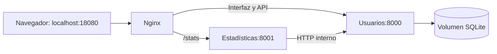

# EP2 - Pipeline CI/CD de dos microservicios

**Asignatura:** DOY0101, Ingeniería DevOps.

**Integrantes:** [Sebastin Orellana](https://github.com/SebaOre) y [Moises Salinas](https://github.com/MoixesMasc).

**Documento principal para corregir la evaluación:** este README.

## Organización según la pauta

El repositorio se agrupa en seis carpetas. La interfaz pertenece al servicio
de usuarios y la automatización y sus configuraciones están reunidas en `devops/`.

```text
.github/        Pipeline de Actions y Dependabot                    (puntos 2 y 3)
backend/        Usuarios: código, frontend y Dockerfile              (punto 1)
estadisticas/   Estadísticas: código y Dockerfile                    (punto 1)
tests/          Pruebas automatizadas                               (punto 2)
devops/         Automatización, Nginx y configuración de SonarQube   (puntos 2 a 4)
docs/           Manual, aportes y evidencias                         (punto 5)
README.md       Informe principal                                   (punto 5)
compose.yaml    Orquestación de los contenedores                     (punto 4)
```

La [revisión de esta estructura en Actions](https://github.com/SebaOre/Devops_Ev-1/actions/workflows/CI.yml?query=branch%3Acodex%2Fordenar-estructura)
registra las comprobaciones de la reorganización. La configuración local del
editor y los archivos temporales están excluidos de GitHub.

## Qué revisar primero

Estas son las tres comprobaciones principales. Cada enlace abre la evidencia
de ejecución; los reportes también están conservados en el repositorio.

| Requisito | Abrir esta evidencia | Resultado registrado |
| --- | --- | --- |
| Se ejecutaron las pruebas | [Job de pruebas y auditorías](https://github.com/SebaOre/Devops_Ev-1/actions/runs/40929310543/job/123643184129) | **57 pruebas aprobadas y cobertura 99,60%.** |
| Se analizó con SonarQube | [Job de SonarQube](https://github.com/SebaOre/Devops_Ev-1/actions/runs/40929310543/job/123643538609) | **Quality Gate OK, seguridad A y cero observaciones.** |
| Hay dos microservicios en Docker | [Construcción de imágenes](https://github.com/SebaOre/Devops_Ev-1/actions/runs/40929310543/job/123644623219) y [salida real de Docker local](docs/evidencias/docker-estado-2026-10-30.txt) | **Imágenes de usuarios y estadísticas; ambos servicios saludables.** |

[Ver el pipeline completo aprobado](https://github.com/SebaOre/Devops_Ev-1/actions/runs/40929310543).
Los resultados remotos anteriores corresponden al **29 de octubre de 2026**,
commit `0243f603d69c777e197463febb7ded705f8c59f7`. La comprobación local de Docker
corresponde al **30 de octubre**. Los cambios posteriores de documentación no
se presentan como nuevas ejecuciones del código.

<a id="docker"></a>

## 1. Los dos microservicios y sus contenedores

| Microservicio | Qué hace | Código y Dockerfile |
| --- | --- | --- |
| **Usuarios** | Crear, listar, consultar, actualizar y eliminar usuarios; sirve la interfaz web y guarda SQLite. | [Código](backend/app) · [Dockerfile](backend/Dockerfile) |
| **Estadísticas** | Consulta usuarios por HTTP y calcula totales y dominios de correo. Tiene su propia API y no accede directamente a SQLite. | [Código](estadisticas/app) · [Dockerfile](estadisticas/Dockerfile) |

Nginx es el proxy de entrada. Por eso Compose muestra **tres contenedores**:
dos microservicios y el proxy.

| Contenedor observado el 30 de octubre | Imagen local | Salud |
| --- | --- | --- |
| `devops-ep2-usuarios-1` | `ep2-usuarios:local` | `healthy` |
| `devops-ep2-estadisticas-1` | `ep2-estadisticas:local` | `healthy` |
| `devops-ep2-gateway-1` | Nginx oficial fijado por versión y digest | `healthy` |

**Cómo comprobarlo:** abrir la [salida real de `docker compose ps` y de las imágenes](docs/evidencias/docker-estado-2026-10-30.txt).
El [reporte local](docs/evidencias/comprobaciones-locales/arranque-2026-10-30.json)
registra también HTTP 200 en interfaz, salud y estadísticas, usuario 10001 y
dependencias compatibles en ambos servicios Python.



La [configuración Compose](compose.yaml) define redes, volumen, salud,
dependencias, límites y ejecución sin privilegios. Solo Nginx publica el puerto
18080. Estadísticas se puede escalar a tres réplicas; la
[verificación de orquestación](docs/evidencias/comprobaciones-locales/compose-verificacion.json)
registró tráfico a tres IPs, persistencia y recuperación ante fallos.

<a id="pruebas"></a>

## 2. Evidencia de las pruebas automatizadas

| Medición | Resultado del reporte |
| --- | --- |
| Casos PyTest | **57 aprobados**, sin fallos ni errores. |
| Líneas Python cubiertas | 211 de 211, **100%**. |
| Ramas cubiertas | 35 de 36, **97,22%**. |
| Cobertura combinada de líneas y ramas | **99,60%**. |
| Umbral exigido por el proyecto | **90%**. |

**Dónde verlo:** en el [job de pruebas](https://github.com/SebaOre/Devops_Ev-1/actions/runs/40929310543/job/123643184129),
expandir **Ejecutar pruebas y verificar cobertura mínima**. El respaldo está
en el [JUnit original](docs/evidencias/run-40929310543/pytest.xml) y el
[XML de cobertura](docs/evidencias/run-40929310543/coverage.xml).

La [suite](tests) cubre CRUD, validación, duplicados, paginación, fallos HTTP,
resúmenes e integridad de artefactos. Utiliza SQLite en memoria y HTTP simulado.
El despliegue agrega comprobaciones reales sobre contenedores. La cobertura
anterior mide los servicios Python; no mide el frontend JavaScript.

<a id="sonarqube"></a>

## 3. Evidencia del análisis con SonarQube

| Medición | Resultado conservado |
| --- | --- |
| Quality Gate | **OK**. |
| Clasificación de seguridad | **A**, valor numérico 1. |
| Cobertura recibida por SonarQube | **99,6%**. |
| Observaciones abiertas | **0**. |
| Security hotspots | **0**. |
| Salida del escáner | **0**, análisis completado. |

**Dónde verlo:** abrir el [job de SonarQube](https://github.com/SebaOre/Devops_Ev-1/actions/runs/40929310543/job/123643538609)
y expandir **Analizar código y exigir aprobación del Quality Gate**. El resultado
también se puede leer en el [reporte del gate](docs/evidencias/run-40929310543/sonarqube-quality-gate.json),
las [observaciones](docs/evidencias/run-40929310543/sonarqube-issues.json) y los
[hotspots](docs/evidencias/run-40929310543/sonarqube-hotspots.json).

Se analizan los servicios Python, el frontend y los Dockerfile. El pipeline
crea una instancia temporal de SonarQube en el runner. Sus resultados quedan
en los logs y reportes aunque esa instancia se retire al finalizar.

Las auditorías de dependencias también terminaron sin avisos:
[usuarios, 23 paquetes](docs/evidencias/run-40929310543/pip-audit-usuarios.json),
[estadísticas, 14](docs/evidencias/run-40929310543/pip-audit-estadisticas.json) y
[entorno, 59](docs/evidencias/run-40929310543/pip-audit-entorno.json).
El [workflow](.github/workflows/CI.yml) bloquea las etapas siguientes cuando una
prueba, auditoría o gate falla. La
[ejecución inicial bloqueada](https://github.com/SebaOre/Devops_Ev-1/actions/runs/40920411784)
registra ese comportamiento ante una dependencia vulnerable, posteriormente corregida.

<a id="despliegue"></a>

## 4. Pipeline, despliegue y trazabilidad

| Orden | Job | Comprobación |
| --- | --- | --- |
| 1 | `validate` | Pruebas, cobertura y auditorías de dependencias. |
| 2 | `sonar` | Análisis y aprobación de SonarQube. |
| 3 | `build` | Construcción y verificación de ambas imágenes. |
| 4 | `deploy` | Carga del paquete en otro runner, Compose, pruebas y limpieza. |

**Dónde verlo:** el [job de despliegue](https://github.com/SebaOre/Devops_Ev-1/actions/runs/40929310543/job/123645208503)
verificó salud, CRUD, estadísticas y persistencia al recrear usuarios. El
[reporte de despliegue](docs/evidencias/run-40929310543/despliegue-simulado.json)
registra estado `passed`, etapa `completed` y limpieza completa, junto a los
[logs de los servicios](docs/evidencias/run-40929310543/despliegue-simulado.log).

Las imágenes llevan el SHA completo del commit y etiquetas OCI de revisión y
repositorio. El manifiesto registra sus identificadores, checksum y ejecución
de origen. El despliegue verifica esos datos y usa el paquete construido, sin
reconstruir los servicios. La URL del runner existe durante la simulación y
deja de estar disponible después de retirar el entorno.

<a id="evidencias"></a>

## 5. Correspondencia con la rúbrica

| Indicador | Implementación y evidencia principal |
| --- | --- |
| IE1: contenedores | Dos microservicios distintos y Dockerfile independientes; ver sección 1 y job `build`. |
| IE2: pruebas | 57 casos aprobados y cobertura 99,60%; ver sección 2. |
| IE3: seguridad y escalabilidad | SonarQube, auditorías, bloqueos, límites y tres réplicas comprobados. Dependabot está configurado y su activación sigue pendiente. |
| IE4: despliegue y trazabilidad | Paquete identificado por commit, verificado y desplegado en otro runner; ver sección 4. |
| IE5: orquestación | Compose con redes, volumen, salud, dependencias, proxy y recuperación; ver sección 1. |

Los [reportes originales](docs/evidencias/run-40929310543) se conservan en el
repositorio porque los artefactos de Actions tienen retención de siete días.
Sus [checksums](docs/evidencias/run-40929310543/SHA256SUMS.txt) permiten detectar
cambios en las copias. El paquete binario de imágenes no se almacena en Git.
El estado de Compose en `*.containers.json` conserva NDJSON, un objeto por línea.

## 6. Cómo ejecutar la aplicación

Con Docker Desktop en modo Linux, Compose y Python 3.11 o posterior, desde la raíz:

```powershell
python devops/iniciar_compose.py
docker compose ps
```

Abrir [localhost:18080](http://localhost:18080/) para la interfaz,
[/docs](http://localhost:18080/docs) para la API de usuarios y
[/stats](http://localhost:18080/stats) para estadísticas. Estas direcciones son
locales al equipo donde se inicia Docker.

Las instrucciones de pruebas, SonarQube, escalado, detención y resolución de
problemas están reunidas en un solo [manual técnico](docs/MANUAL_TECNICO.md).

<a id="uso-de-ia"></a>

## 7. Uso de inteligencia artificial

La asistencia incluyó revisión de requisitos, modificación de código, pruebas y documentación descriptiva.
También incluyó interpretación de sus resultados.
Las firmas de Git identifican la cuenta utilizada y no distinguen por sí solas
trabajo manual y asistencia.

[archivo del equipo](docs/APORTES_Y_CONCLUSIONES.md).

Referencia de la herramienta: OpenAI
<a id="como-entregar"></a>

