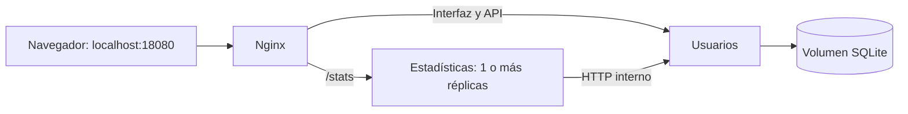

# Evaluación Parcial 2 - Ingeniería DevOps

Proyecto de **DOY0101**: dos microservicios Python, contenedores, pruebas,
análisis de seguridad y despliegue automático simulado con GitHub Actions y
Docker Compose.

Integrantes confirmados: [SebaOre](https://github.com/SebaOre) y
[MoixesMasc](https://github.com/MoixesMasc). Ver [identificación y aportes](docs/EQUIPO.md).
**Estado:** pasos 1 a 8 verificados; documentación técnica del paso 9 preparada.
Quedan los textos de autoría del equipo y la revisión de entrega.
Ver [PROGRESO_EP2.md](docs/PROGRESO_EP2.md).

## Aplicación y arquitectura

| Componente | Función | Puerto interno | Persistencia |
| --- | --- | --- | --- |
| Usuarios | CRUD de usuarios y frontend. | 8000 | SQLite en `/data`, volumen `usuarios_data`. |
| Estadísticas | Consulta HTTP a usuarios y resumen por dominios de correo. | 8001 | Sin estado. |
| Nginx | Entrada HTTP, rutas y balanceo de estadísticas. | 8080 | Configuración en solo lectura. |



Los servicios Python tienen Dockerfile independientes. Compose define redes,
volumen, dependencias de salud, límites y ejecución sin privilegios. Solo Nginx
publica un puerto del equipo.

## Inicio local

Requisitos: Docker Desktop con motor Linux, Docker Compose y Python 3.11 o
posterior para los scripts. Desde la raíz del repositorio:

```powershell
python scripts/iniciar_compose.py
docker compose ps
```

El lanzador construye ambas imágenes y espera su salud. En Windows usa
`docker build` seguido de Compose para evitar el fallo de Bake observado con
los caracteres de esta ruta. No requiere crear `.env`.

| Dirección | Contenido |
| --- | --- |
| [localhost:18080](http://localhost:18080/) | Interfaz de usuarios. |
| [Usuarios](http://localhost:18080/users/) | API de usuarios. |
| [Swagger](http://localhost:18080/docs) | Operaciones de usuarios. |
| [Estadísticas](http://localhost:18080/stats) | Resumen por dominio. |
| [Salud](http://localhost:18080/health) | Salud de usuarios. |

Escalar estadísticas y detener conservando los datos:

```powershell
docker compose up -d --scale estadisticas=3 --wait
docker compose down
```

Ver [COMPOSE.md](docs/COMPOSE.md) para puertos, recursos, persistencia y escalado.

## Pipeline CI/CD

[CI.yml](.github/workflows/CI.yml) se activa con pushes a `main`, `develop`,
`feature/**` y `codex/**`, Pull Requests hacia `main` o `develop`, y ejecución
manual. Utiliza Ubuntu 24.04 y Python 3.11.

| Job | Operaciones y aprobación |
| --- | --- |
| `validate` | Sintaxis, PyTest, cobertura mínima del 90% y tres auditorías de dependencias con `pip-audit`. |
| `sonar` | Necesita `validate`; recupera cobertura y exige Quality Gate: seguridad A y cobertura mínima del 90%. |
| `build` | Necesita pruebas y SonarQube; construye, etiqueta por SHA, empaqueta y verifica ambas imágenes. |
| `deploy` | Necesita las etapas anteriores; carga ese paquete en otro runner, despliega Compose, prueba APIs y persistencia, guarda evidencia y retira el entorno. |

Los fallos bloquean las etapas dependientes y generan anotaciones de error.
No se utiliza `continue-on-error`. La simulación vive en el runner durante la
verificación; su URL local no permanece publicada después de la limpieza.

## Trazabilidad y calidad

La [ejecución completa aprobada del 29 de octubre de 2026](https://github.com/SebaOre/Devops_Ev-1/actions/runs/40929310543)
corresponde al commit `0243f603d69c777e197463febb7ded705f8c59f7`:

- **57 pruebas aprobadas**, cobertura de servicios de **99,60%**.
- Auditorías de usuarios, estadísticas y entorno sin vulnerabilidades conocidas.
- SonarQube: gate `OK`, seguridad A, cero observaciones y hotspots.
- Las mismas imágenes construidas se cargaron y ejecutaron en el despliegue.
- CRUD, comunicación HTTP, persistencia y limpieza aprobados.

Las etiquetas OCI registran revisión y repositorio. El manifiesto conserva
referencias, identificadores, checksum SHA-256 y ejecución de origen. El
despliegue comprueba esos datos antes de iniciar Compose. Los artefactos de
Actions se conservan siete días; una copia revisada de los reportes está en
[EVIDENCIAS.md](docs/EVIDENCIAS.md).

La suite usa SQLite en memoria y HTTP simulado; Docker y el despliegue se prueban
además con contenedores reales. La cobertura publicada mide Python y no las
líneas del frontend JavaScript.

## Pruebas locales

```powershell
python -m venv .venv
.\.venv\Scripts\python.exe -m pip install -r requirements-test.txt -r requirements-security.txt
.\.venv\Scripts\python.exe -m pytest
.\.venv\Scripts\python.exe scripts/auditar_dependencias.py
```

[Dependabot](.github/dependabot.yml) está configurado. Su integración en la rama
predeterminada y la protección de ramas siguen pendientes de la revisión final;
`needs` ya bloquea las etapas del pipeline ante fallos.

## Documentación y entrega

| Documento | Contenido |
| --- | --- |
| [Docker](docs/DOCKER.md) / [Compose](docs/COMPOSE.md) | Construcción, redes, persistencia, límites y escalado. |
| [Pruebas](docs/PRUEBAS.md) / [Seguridad](docs/SEGURIDAD.md) | Casos, cobertura, auditorías, SonarQube y bloqueos. |
| [Pipeline](docs/PIPELINE.md) / [Despliegue](docs/DESPLIEGUE.md) | Orden, artefactos, identidad y simulación. |
| [Evidencias](docs/EVIDENCIAS.md) | Relación con IE1-IE5 y resultados conservados. |
| [Uso de IA](docs/USO_IA.md) | Herramienta, alcance real y referencias. |
| [Equipo](docs/EQUIPO.md) | Identificación y aportes pendientes de completar. |
| [Justificaciones](docs/JUSTIFICACIONES_EQUIPO.md) | Sección reservada a la autoría del equipo. |
| [Conclusiones](docs/CONCLUSIONES.md) | Secciones personales sin respuestas generadas por IA. |
| [Entrega](docs/ENTREGA_EP2.md) | Comprobaciones y pendientes antes de entregar. |

La documentación descriptiva contó con asistencia de IA y requiere revisión
del equipo. Las conclusiones, justificaciones técnicas y reflexiones deben
completarse con autoría de los estudiantes, según la pauta.
El README anterior se conserva en [EA1_README_ORIGINAL.md](docs/EA1_README_ORIGINAL.md).
