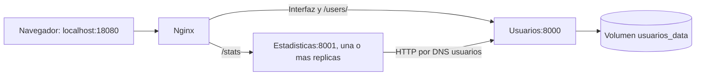

# Orquestacion con Docker Compose

## Iniciar la aplicacion

Desde la raiz del repositorio, con Docker Desktop iniciado:

```powershell
python scripts/iniciar_compose.py
docker compose ps
```

| Direccion | Contenido |
| --- | --- |
| `http://localhost:18080/` | Interfaz de usuarios. |
| `http://localhost:18080/users/` | API de usuarios. |
| `http://localhost:18080/docs` | Documentacion interactiva de usuarios. |
| `http://localhost:18080/stats` | Resumen calculado por estadisticas. |
| `http://localhost:18080/health` | Salud del servicio de usuarios. |
| `http://localhost:18080/proxy-health` | Salud del proxy. |

El lanzador construye secuencialmente las imagenes locales `ep2-usuarios:local`
y `ep2-estadisticas:local`, y ejecuta Compose con `--no-build --wait`.
Si se reconstruyen, los datos de usuarios permanecen en el volumen.
Los comandos equivalentes son:

```powershell
docker build -f backend/Dockerfile -t ep2-usuarios:local .
docker build -f estadisticas/Dockerfile -t ep2-estadisticas:local .
docker compose up -d --no-build --wait
```

En este equipo, `docker compose up --build` fallo en Bake con un encabezado
gRPC que contenia caracteres no ASCII de la ruta del proyecto. La construccion
directa de Docker funciono en la misma ubicacion. El lanzador usa esa secuencia.

## Componentes y comunicacion



Hay dos microservicios y un proxy de entrada que usa la imagen oficial de Nginx,
fijada por version y digest. Nginx resuelve los nombres con el DNS interno de
Docker y actualiza las direcciones cada cinco segundos. El reparto entre
replicas de estadisticas usa round robin.

Los servicios Python comparten la red `servicios`, marcada como interna, y no
publican puertos en el equipo. Nginx pertenece tambien a `entrada` y publica
unicamente `127.0.0.1:18080`. El frontend consulta la API en el mismo origen.

`estadisticas` espera a que `usuarios` este `healthy`. Nginx espera a ambos.
El parametro `--wait` comprueba la salud de los servicios antes de dar el
arranque por terminado.

## Persistencia y detencion

Usuarios guarda SQLite en `/data/microservicio.db`, dentro del volumen
`usuarios_data`. Con el nombre de proyecto predeterminado, Docker lo identifica
como `devops-ep2_usuarios_data`.

```powershell
docker compose down
docker compose up -d --wait
```

`down` elimina los contenedores y las redes del proyecto y conserva el volumen.
Volver a iniciar el mismo proyecto recupera los registros. Agregar `--volumes`
al comando `down` elimina tambien los datos del volumen; la verificacion
automatizada usa esa opcion solo sobre su proyecto temporal de pruebas.

## Escalabilidad

```powershell
docker compose up -d --scale estadisticas=3 --wait
docker compose ps
```

Nginx mantiene el puerto 18080 y distribuye `/stats` entre las tres replicas.
Estadisticas no guarda estado ni necesita un volumen propio. No se usa
`container_name`, por lo que Compose puede crear varias instancias del servicio.

Para volver a una replica:

```powershell
docker compose up -d --scale estadisticas=1 --wait
```

Usuarios se mantiene en una instancia con SQLite. Para escalarlo tambien, se
deberia migrar la persistencia a una base externa adecuada para varias instancias.
Esta configuracion demuestra escalado horizontal del servicio sin estado.

## Seguridad y limites

| Servicio | Usuario | CPU maxima | Memoria maxima | PIDs maximos |
| --- | --- | --- | --- | --- |
| Usuarios | 10001:10001 | 0,50 CPU | 256 MiB | 128 |
| Cada replica de estadisticas | 10001:10001 | 0,50 CPU | 128 MiB | 128 |
| Nginx | 101:101 | 0,25 CPU | 64 MiB | 64 |

Con una replica de estadisticas, los limites suman 448 MiB; con tres, 704 MiB.
Son limites de los contenedores en ejecucion, no del proceso de construccion
ni del motor Docker.

Los tres servicios tienen:

- Raiz del sistema de archivos de solo lectura.
- Capacidades Linux eliminadas y `no-new-privileges`.
- `/tmp` temporal de 16 MiB con `noexec` y `nosuid`.
- Memoria mas intercambio limitada al mismo valor que la memoria, sin swap
  adicional para los procesos de estos contenedores.
- Proceso init, apagado por senal y reinicio `unless-stopped`.
- Logs con rotacion de 5 MB y dos archivos por contenedor.

Solo usuarios puede escribir en el volumen de datos. Nginx recibe su
configuracion mediante un montaje de solo lectura.

Un estado `unhealthy` por si solo no reinicia el contenedor: la politica de
reinicio actua cuando el proceso termina. Si usuarios no responde, `/stats`
devuelve 503. La salud del proxy comprueba su propio proceso; `/stats` comprueba
tambien la comunicacion real entre los microservicios.

Al retirar una replica, pueden producirse errores transitorios mientras el DNS
y los reintentos del proxy se ajustan. La verificacion exige recuperacion
automatica y trafico estable; no presupone cero errores durante una caida abrupta.

## Cambiar puerto o imagenes

No es obligatorio crear un archivo `.env`: Compose tiene valores por defecto.
`.env.example` muestra las variables disponibles. Para usar otro puerto en la
sesion de PowerShell:

```powershell
$env:APP_PORT = "18765"
docker compose up -d --wait
```

Tambien se admiten `USUARIOS_IMAGE` y `ESTADISTICAS_IMAGE` con referencias
completas de imagen. Esto permite usar etiquetas del commit en el despliegue
automatizado de los pasos siguientes.

## Verificacion reproducible

```powershell
python scripts/verificar_compose.py
```

El script usa un nombre de proyecto aleatorio y un puerto libre. Necesita que
las tres imagenes esten disponibles localmente. Comprueba:

1. Inicio saludable, frontend y las dos APIs por Nginx.
2. Configuracion efectiva de usuarios, permisos y limites de CPU y memoria.
3. Tres replicas atendiendo solicitudes, comprobadas por sus IPs en los logs,
   sin recrear el proxy.
4. Recuperacion tras detener una replica.
5. Persistencia de dos usuarios despues de `down` y `up`.
6. Error 503 al detener usuarios y recuperacion al volver a iniciarlo.

Guarda `reports/compose-verificacion.json` y elimina sus propios contenedores,
redes y volumen al terminar. El proyecto de uso normal se mantiene separado de
esta comprobacion.

## Referencias

- [Servicios y limites en Compose](https://docs.docker.com/reference/compose-file/services/).
- [Orden de inicio y service_healthy](https://docs.docker.com/compose/how-tos/startup-order/).
- [Balanceo y resolucion de DNS de Nginx](https://nginx.org/en/docs/http/ngx_http_upstream_module.html).

## Resultado verificado

El 29 de octubre de 2026 la verificacion automatizada termino con codigo 0.
Las tres IPs de estadisticas atendieron consultas y el proxy mantuvo su mismo
contenedor durante el escalado. Al retirar una replica, la comprobacion final
no registro errores transitorios. La persistencia y la recuperacion de la
dependencia de usuarios tambien aprobaron.

El lanzador completo dejo los tres servicios normales saludables y las rutas
de la aplicacion respondieron por `http://localhost:18080`. Se eligio ese puerto
porque 8080 estaba ocupado por otro servicio del equipo.
