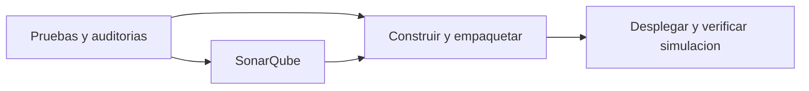

# Despliegue automatico simulado

El job `deploy` de `.github/workflows/CI.yml` necesita la aprobacion de
`validate`, `sonar` y `build`. Se ejecuta automaticamente en los eventos del
pipeline: pushes a las ramas configuradas, Pull Requests y ejecucion manual.



## Secuencia del despliegue

1. Un runner nuevo descarga el mismo commit y el artefacto `imagenes-<SHA>`
   producido por `build` en la misma ejecucion.
2. `scripts/desplegar_simulado.py` comprueba el repositorio, commit, checkout
   limpio, ID e intento de ejecucion. Revisa el checksum del archivo, carga las
   imagenes y verifica sus identificadores y etiquetas OCI.
3. El script configura Compose con las referencias del manifiesto. Descarga el
   proxy Nginx fijado por digest e inicia un proyecto de nombre unico, mediante
   `up --no-build --pull never --wait`. Las imagenes Python proceden del paquete.
4. Espera los tres servicios saludables. El proxy publica un puerto aleatorio
   de `127.0.0.1`; el volumen SQLite pertenece exclusivamente a esta simulacion.
5. Prueba frontend, salud, creacion, consulta, actualizacion, eliminacion y
   resumen por dominios. Recrea usuarios y comprueba que los dos registros
   persistan y que estadisticas se recupere usando el DNS interno.
6. Guarda el estado y los logs, ejecuta `down --volumes` y comprueba que no
   queden contenedores, redes ni volumenes con la etiqueta de ese proyecto.

La simulacion se aloja durante la verificacion en el runner de GitHub. Su URL
local deja de estar disponible al retirar el proyecto. El resultado entregable
es la ejecucion aprobada y sus evidencias; la aplicacion local del estudiante
se administra por separado con [COMPOSE.md](COMPOSE.md).

## Reportes y fallos

El artefacto `despliegue-<SHA>` conserva durante siete dias:

- `despliegue-simulado.json`: revision, proyecto, manifiesto original, checksum,
  ejecucion que construyo las imagenes, ejecucion que las desplego, referencias,
  identidades de contenedores e imagenes, salud, pruebas, fechas UTC y limpieza.
- `despliegue-simulado.log`: logs de los tres servicios antes de retirar el entorno.
- `despliegue-simulado.containers.json`: estado de Compose previo a la limpieza.

El resumen del job tambien registra el commit, las comprobaciones y la limpieza.
Un paquete incorrecto impide crear el entorno. Un fallo de arranque, API,
persistencia o limpieza devuelve codigo distinto de cero: GitHub marca el job
como fallido y agrega una anotacion de error. La recoleccion de evidencia se
ejecuta con `if: always()`.

Para reintentar en GitHub, usar **Re-run all jobs**: el control exige que el
paquete haya sido construido en el mismo intento que lo despliega. Repetir
solo `deploy` con un paquete de un intento anterior provoca un rechazo de
trazabilidad.

El retiro de recursos afecta solo al proyecto aleatorio que genero el script.
Cada nueva ejecucion comienza con un proyecto y un volumen independientes.
La simulacion verifica una instalacion temporal; no modela una actualizacion
sobre una instalacion productiva con datos previos.

## Comprobacion local

Con Docker Desktop disponible y el paquete generado en el paso 7:

```powershell
.\.venv\Scripts\python.exe scripts/desplegar_simulado.py --revision working-tree
```

`working-tree` corresponde al paquete construido con
`construir_imagenes.py --local`. Para un paquete generado por GitHub, indicar
su SHA completo. En CI
solo se aceptan el commit y la ejecucion correspondientes al workflow actual.

Para ensayar un fallo despues del arranque:

```powershell
.\.venv\Scripts\python.exe scripts/desplegar_simulado.py --revision working-tree --simulate-failure
```

Este comando debe terminar con codigo 1 y guardar un reporte `failed` con
limpieza completada. Usa archivos `despliegue-simulado-fallo.*` para conservar
el resultado positivo anterior. La opcion esta restringida al uso local.

## Evidencias

El 29 de octubre de 2026 el ensayo local termino con codigo 0. Los tres
servicios alcanzaron estado saludable, se verificaron CRUD, estadisticas y
persistencia al recrear usuarios. Los identificadores de ambas imagenes en
ejecucion coincidieron con el manifiesto. El retiro final no dejo contenedores,
redes ni volumenes de ese proyecto. La aplicacion normal continuo disponible
en el puerto 18080.

El ensayo de fallo intencional termino con codigo 1, registro el error y retiro
todos sus contenedores, redes y volumenes. Los logs y el estado previo al retiro
quedaron guardados con el sufijo `-fallo`. Los dos ensayos usaron el paquete de
comprobacion local del paso 7, identificado como `working-tree`.

La [ejecucion real de GitHub Actions](https://github.com/SebaOre/Devops_Ev-1/actions/runs/40929310543)
del commit `0243f603d69c777e197463febb7ded705f8c59f7` aprobo los cuatro jobs el
29 de octubre de 2026. El despliegue cargo las imagenes en un runner nuevo,
verifico las cinco agrupaciones de pruebas funcionales y termino con estado
`passed`, etapa `completed` y limpieza completada sin recursos restantes.

| Servicio | ID de imagen construido, cargado y ejecutado |
| --- | --- |
| Usuarios | `sha256:8660dd8ce8c22ada95c8ca463d756ff3534c6350462ea4c033a28a0eae6e0ff0` |
| Estadisticas | `sha256:fc4c19574aa5b9a27dea585d5da68c612695e95c014feae3a7ec38d8a518d32c` |

El archivo `images.tar.gz` midio 81.855.582 bytes y su SHA-256 fue
`bfe07c0a502f89b4015a9f24e450cc04c527a09dd06e02cf42f2a32b619b04c9`.
Construccion y despliegue compartieron el ID de ejecucion `40929310543` y el
intento `1`. El contenedor de usuarios cambio de ID al recrearse, manteniendo
su imagen y los dos registros verificados.

El [artefacto de despliegue](https://github.com/SebaOre/Devops_Ev-1/actions/runs/40929310543/artifacts/12921823648)
incluye reporte, logs y estado de Compose; su retencion es de siete dias.
Las copias locales estan en `reports/github-run-40929310543/`, excluido de Git.
